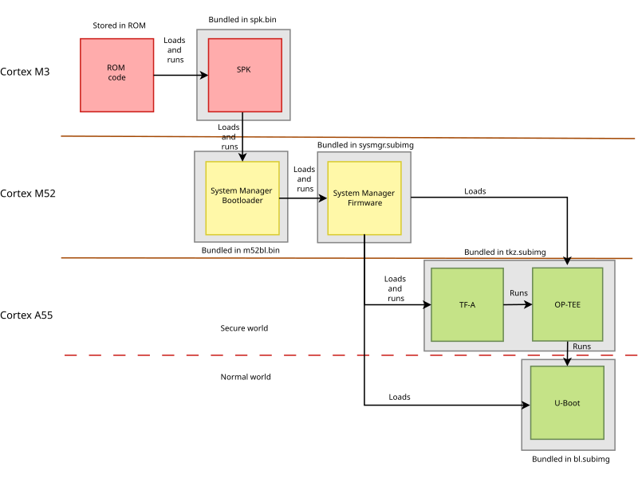

.. SPDX-License-Identifier: GPL-2.0+

Synaptics Astra SL2619 RDK
==========================

The Synaptics SL2619 is an ARM64 SoC with a dual-core Cortex-A55. The
SL2619 RDK (Astra Machina) is the corresponding reference design.

Official documentation can be found here:
https://synaptics-astra.github.io/doc/v/latest

Along with official github page:
https://github.com/synaptics-astra

Mainline support
----------------

This is early stage support with:

1. ns16550 UART
2. CPU reset via PSCI
3. Generic ARMv8 core timer

Boot Flow
---------
Below is the pictorial representation of boot flow:

Building
--------

U-Boot
^^^^^^
.. code-block:: console

   export CROSS_COMPILE=aarch64-linux-gnu-
   make synaptics_sl2619_defconfig
   make

This will generate ``u-boot.bin``.

Generate ``bl.subimg``
^^^^^^^^^^^^^^^^^^^^^^

The boot flow expect a bootloader encapsulated in a ``bl.subimg`` file.

Synaptics provides tools in order to do that:

.. code-block:: console

    git clone -b scarthgap_6.12_v2.5.0 https://github.com/synaptics-astra/build.git
    git clone -b scarthgap_6.12_v2.5.0 https://github.com/synaptics-astra/security.git
    git clone https://github.com/synaptics-astra/usb-tool.git

    build/tools/bin/in_extras.py BOOT_LOADER_GENX_V3 in_boot_loader_extras.bin 0x00000000 0x00000000 0x600000 0x600000
    build/tools/bin/gen_x_secure_image --chip-name=klamath --chip-rev=A0 \
    	--img_type=BOOT_LOADER --key_type=ree --length=0x0 \
    	--extras=in_boot_loader_extras.bin \
    	--workdir-security-tools=build/tools/lib/sec_tools/bin \
    	--workdir-security-keys=security/keys/chip/klamath/A0 \
    	--tool-version=genx_v3 \
    	--in_payload=u-boot/u-boot.bin \
    	--out_store=usb-tool/astra-usbboot-images/sl2619/bl.subimg

Booting
-------

USB-BOOT
^^^^^^^^

Reset the board while pressing the USB_BOOT button, then:

.. code-block:: console

    sudo ./usb-tool/bin/linux/x86_64/astra-boot -b bootloader usb-tool/astra-usbboot-images/sl2619

Console
-------

The console is on UART0 (``sm_uart0``, 0xe5030000) at 115200n8.

Sample boot log
---------------

.. code-block:: none

   U-Boot 2026.10-00019-gda155cd176f0 (Oct 20 2026 - 16:44:30 +0200)

   Model: Synaptics SL2619 RDK
   DRAM:  2 GiB
   Core:  28 devices, 14 uclasses, devicetree: separate
   Loading Environment from nowhere... OK
   In:    serial@e5030000
   Out:   serial@e5030000
   Err:   serial@e5030000
   =>
